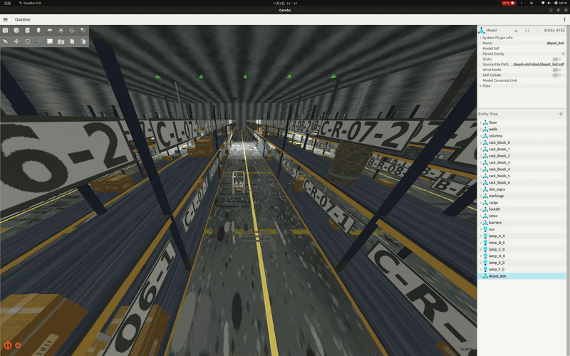

# depot-vln

**A mecanum-wheeled warehouse robot that turns natural language into navigation — with a semantic
map grown from perception, not copied from ground truth.**

`depot-vln` is a reference implementation of an Amazon-style automated warehouse in simulation.
A 4-wheel mecanum platform drives a 6-aisle rack warehouse (24 bays per aisle, 2 levels), plans and
localizes with **ROS 2 Humble + Nav2**, looks at racks with a **stereo camera**, and executes commands
such as *"go to bay 10"*, *"which rack face has the most cartons?"* or *"go to the empty slot farthest
inside aisle A"* through a **LangGraph** agent.

> 中文说明（含设计细节与限制清单）见 [README.md](README.md)。自然语言输入支持中文与英文，
> agent 的回答目前是中文。

The point of the project is not the demo video. It is three boundaries that are enforced by code and
tests, not by convention:

1. **The runtime never reads ground truth.** `world.py`, the semantic map, and `agent/**` have no
   `ground_truth` dependency; `tests/test_runtime_isolation.py` checks the import graph with AST.
   Ground truth is only allowed in `sim.py` (explicit stand-in), `scoring.py`, and `eval/`.
2. **Only the `act` node calls the action interface.** `resolve` / `plan` / `verify` may query, plan,
   and observe; only `act` calls `navigate`. That is graph topology, not discipline.
3. **"Unobserved" is a first-class state.** A slot that was never seen is not empty. `resolve()`
   returns `UNOBSERVED` and the benchmark counts *silent wrong answers* separately from ordinary
   failures. Guessing is a zero-tolerance metric.

## Results

| What | Result |
|---|---|
| 54 hand-written instruction cases, rule NLU, simulated inventory | **54/54**, silent wrong **0** |
| Same cases on the real perception inventory (**8.3%** coverage) | **36/54**, silent wrong **0** |
| SEG-2 rack detector, aisle A (48 frames) | precision **1.000** / recall **0.912** / class top-1 **0.935** |
| SEG-2 rack detector, aisle B (39 frames) | precision **1.000** / recall **0.923** / top-1 **0.958** |
| Offline test suite | **61** pytest tests |
| Gazebo criteria M1/M2/SLAM-1/SEG-1 | pre-refactor numbers only; not re-run (see [docs/LIMITATIONS.md](docs/LIMITATIONS.md)) |

The perception benchmark being lower is the honest result of removing ground truth from the semantic
map: with only 48 of 576 slots observed, the agent must say "I have not seen that" instead of inventing
an answer. Aisle C of SEG-2 currently fails for a documented capture-geometry reason (see A6 in
[docs/LIMITATIONS.md](docs/LIMITATIONS.md)); the committed `results/seg2.json` is the aisle-A run.

## How it is put together

```
config/world.yaml + semantics.yaml + nav.yaml     ← the only place to edit the world
              │
              ▼
      depot_vln/catalog.py                        ← single source of world facts
              │
    ┌─────────┼───────────────────────┐
    ▼         ▼                       ▼
 layout.py   semantic_graph.py     agent/nlu (rule | LLM)
 (SDF +      (Dijkstra over        (slots → query.kind)
  slot grid)  aisles/stations)
    │                               │
    ▼                               ▼
 world/slot_grid.json          LangGraph agent
    │                          understand → resolve → plan → act → verify → respond
    ▼                                      │
 world.py (resolve / plan / observe) ◄─────┘
    ▲
    │  results/inventory.json  ◄── stereo camera / SEG-2 detector / VLM verify
    │
 semantics.py (confidence decay, conflicts, UNOBSERVED)
```

`world.py` is the runtime world. It knows geometry and the inventory snapshot, but not ground truth.
`depot_vln/sim.py` is the one module that samples the world generator to make the offline benchmark
possible; its provenance is always labelled `sim-sampled`.

## Repository layout

```
config/          world, language lexicon, navigation parameters
depot_vln/       the library: catalog, layout, semantic graph, inventory, agent, eval
scripts/         simulation, capture, judging, and world-generation entry points
examples/        four small runnable demos (offline)
tests/           unit tests + anti-hardcoding / ground-truth-isolation guards
world/           generated SDF and slot grid (SDF is generated, not committed)
ground_truth/    deterministic world truth (build-time only)
maps/            static map used by Nav2 (PGM is generated)
results/         checked-in evidence: benchmarks, detector scores, criteria JSON
docs/            architecture and the authoritative limitations list
Makefile         one command per task (`make help`)
```

## Requirements

* Ubuntu 22.04, Python 3.10
* ROS 2 Humble, Nav2, Gazebo Fortress (`ros_gz`)
* A GPU is recommended for rendering; software rendering works but is slow
* Optional: [Ollama](https://ollama.com/) for the LLM / VLM backends

Developed and tested on Ubuntu 22.04 with ROS 2 Humble and Gazebo Fortress 6.18.
The same offline assertions are wired into GitHub Actions on a clean Python 3.10 runner
([.github/workflows/verify.yml](.github/workflows/verify.yml)).

## Installation

### 1. ROS 2, Gazebo, Nav2

Install ROS 2 Humble with the official
[Debian packages](https://docs.ros.org/en/humble/Installation/Ubuntu-Install-Debs.html), then:

```bash
sudo apt update
sudo apt install -y \
  ros-humble-desktop \
  ros-humble-ros-gz \
  ros-humble-navigation2 ros-humble-nav2-bringup \
  ros-humble-slam-toolbox ros-humble-robot-localization \
  ros-humble-pointcloud-to-laserscan ros-humble-xacro \
  python3-venv python3-pip python3-numpy python3-opencv python3-pil \
  python3-matplotlib fonts-dejavu-core

# optional: only needed for the S4 visual-odometry experiment
sudo apt install -y ros-humble-rtabmap-ros

echo 'source /opt/ros/humble/setup.bash' >> ~/.bashrc
source /opt/ros/humble/setup.bash
```

Check that the Gazebo bridge is present:

```bash
ros2 pkg prefix ros_gz_sim
ign gazebo --version        # should report Fortress (Gazebo Sim 6.x)
```

If `ign` is missing: `sudo apt install ignition-fortress`.

### 2. Python environment

```bash
cd ~/depot-vln
python3.10 -m venv --system-site-packages .venv
source .venv/bin/activate
python -m pip install -U pip
pip install -r requirements.txt
pip install "pytest>=7"
```

`--system-site-packages` is intentional: NumPy, OpenCV, and Pillow come from the Ubuntu packages
installed above.

### 3. Generate the world and the static map (required)

The SDF and the Nav2 map are generated artifacts, not committed:

```bash
make world        # ~30 s; writes world/, ground_truth/, maps/
make verify       # 22 structural checks on the generated world
make map-check    # map must cover every static collider
```

If you skip this step, `make sim` has no `world/warehouse.sdf` to load.

### 4. Smoke test (no ROS, no GPU)

```bash
make ci
```

Expected tail:

```
61 passed
backend=rule  inventory=sim-sampled  n=54  wall=...
...
合计              54    54   100.0%       0
...
离线判据链：全部通过（test / bench / guard-selftest）
```

## Offline demos

### Instruction benchmark

```bash
make bench
```

```
backend=rule  inventory=sim-sampled  n=54  wall=...
类别               n    ok     rate  silent
direct          14    14   100.0%       0
attribute       14    14   100.0%       0
ambiguous       14    14   100.0%       0
unreachable     12    12   100.0%       0
合计              54    54   100.0%       0
```

Now rebuild the inventory from the checked-in perception result and run the same benchmark against it:

```bash
make inventory          # 48 observations -> results/inventory.json (coverage 8.3%)
make bench-perception
```

```
合计              54    36    66.7%       0
```

`36/54` is not a regression; it is what the agent can honestly answer with 8.3% coverage.
`silent = 0` means it never guesses.

### The four runnable examples

```bash
.venv/bin/python examples/01_query_to_plan.py
```
Shows one sentence going through `RuleNLU` → `compile_query` → `resolve` → `plan`:
24 candidates for "bay 10", one target + a 22.8 m plan for a full address, and `EMPTY_BAY` for a
category that is not in that bay.

```bash
.venv/bin/python examples/02_agent_graph.py
```
Runs the full LangGraph agent, including the clarification `interrupt`, and prints the node trace:

```
> 去 10 号位
  agent asks : 「去 10 号位」有几个可能的货位：A-L-10-1、...（共 24 个候选）。你指的是哪一个？
  user says  : C 巷左边第一层
  node trace : understand > resolve > clarify > resolve > plan > act > verify > respond
  target     : C-L-10-1
  answer     : 已到达 C-L-10-1（走 25.1 m，行驶 64.6 s，核验 0.8 s）。现场核验：有货，类别 carton_m
```

```bash
.venv/bin/python examples/03_perception_and_unknown.py
```
Loads the real perception snapshot and shows the refusal behavior: `UNOBSERVED` for "which rack face
has the most cartons", two zero-score candidates for "the rack face with oil drums in aisle A", and a
direct address that still resolves.

```bash
.venv/bin/python examples/04_langgraph_hitl.py --step 1
.venv/bin/python examples/04_langgraph_hitl.py --step 2 --answer "C 巷左边第一层"
```
This is the LangGraph-specific demo: **interrupt → SQLite checkpoint → new process resume**.
Step 1 hits `clarify`, prints the 24 candidates and exits with the graph suspended. Step 2 is a
separate process that loads the same `thread_id` from `state/demo_hitl.sqlite`, resumes with
`Command(resume=...)`, and prints `understand > resolve > clarify > resolve > plan > act > verify > respond`
and the final answer. `--graph` also prints the compiled graph as Mermaid. Step 1 resets the demo
checkpoint by default so it always starts at the interrupt; use `--keep` to inspect an existing one.

> Demo 4 is **terminal-only**: it uses the offline tool layer, so an open Gazebo window will not
> move. For a LangGraph run that drives the simulator, use Demo 2 with an ambiguous command
> (`UTT="去 10 号位" ANSWER="C 巷左边第一层"`).

### Dry-run the real tool layer

This exercises the same graph but with the simulation tool layer in dry mode (no ROS, no motion):

```bash
make p6-demo DRY=1 UTT="去 B-L-07-2"
```

It prints the 9 graph legs and a final `RESULT: PASS`, and writes
`results/p6_demo_<timestamp>.json` plus `transitions/p6_<timestamp>.jsonl`.

## Demo clip



Short preview of the Gazebo run. The full 78 s recording is [`warehouse_demo_720p.mp4`](docs/media/warehouse_demo_720p.mp4) (4.4 MB, 720p). The raw 266 MB WebM is intentionally gitignored; see [docs/media/README.md](docs/media/README.md).

## Simulation demos

The world must be generated first (`make world`). To record the three demos with the Gazebo GUI
(Nav2, natural-language command, SEG-2 capture), see [docs/DEMO_GUI.md](docs/DEMO_GUI.md);
put the resulting GIFs in [docs/media/](docs/media/README.md).

### End-to-end natural-language command

One command orchestrates: rebuild the robot, start Gazebo headless, start the camera bridge, run the
agent, score the result, tear everything down.

```bash
make down                                  # clean any previous stack
make p6-demo UTT="去 B-L-07-2" VERIFY=depth
```

`VERIFY=depth` uses the stereo depth gate and needs no model server. Expect 5–15 minutes depending on
GPU / RTF. Keep the stack alive for inspection with `KEEP=1`; stop it with `make down`.

Ambiguous command with a supplied clarification:

```bash
make p6-demo UTT="去 10 号位" ANSWER="C 巷左边第一层" VERIFY=depth
```

If you have Ollama and want the VLM verifier instead:

```bash
ollama serve &
ollama pull qwen3-vl:8b
make p6-demo UTT="去 B-L-07-2" VERIFY=vlm
```

### Manual simulation + Nav2

Terminal 1 — start the simulation (headless; use `gui:=true` on a desktop):

```bash
make down
make sim SIM_ARGS="gui:=false"
```

Wait until Gazebo is up, then terminal 2 — drive a goal with Nav2. `make nav-to` starts the Nav2 stack
itself if it is not running and stops it afterwards:

```bash
make nav-to X=-20 Y=-10.75        # inside aisle A (center y = -10.75)
```

Useful variants:

```bash
KEEP=1 make nav-to X=-20 Y=-10.75          # leave Nav2 running
make nav-to X=-20 Y=-10.75 YAW=90          # final heading in degrees
make down                                  # stop simulator + bridges + Nav2
```

Coordinates are in the world frame. The spawn point is derived from the world geometry
(approximately `x = -31.05, y = 0`); aisle centers are A `-10.75`, B `-6.45`, C `-2.15`,
D `+2.15`, E `+6.45`, F `+10.75`.

### SEG-2 perception capture (recordable)

This is where the semantic inventory comes from: at each bay the robot turns ±90° to the rack and
captures one RGB-D frame per side.

```bash
make down
make seg2-robot                     # 640×480 @10 Hz, camera pitch 16° (SEG-2 profile)
make sim SIM_ARGS="gui:=true"
```

In a second terminal:

```bash
make cam-bridge
```

In a third terminal:

```bash
rm -f results/seg2_frames_demo.npz    # otherwise an existing capture is skipped
make seg2-capture AISLE=A BAYS=1-2 OUT=results/seg2_frames_demo.npz
```

Four observations (2 bays × L/R) are enough to show the loop: drive to a bay, turn to the rack,
capture, turn to the other side, capture, move to the next bay. See
[docs/DEMO_GUI.md](docs/DEMO_GUI.md) for the full recording setup and cleanup.

## Troubleshooting

| Symptom | Fix |
|---|---|
| `make sim` refuses to start: a stack is already running | `make down` first. Never run two Gazebo servers: they share the GPU and can freeze the desktop. |
| `libEGL warning ... failed to create dri2 screen`, or no lidar data | Prefer the default GPU offload; if the driver cannot render at all, use `make sim SIM_ARGS="gui:=false software_render:=true gpu_offload:=false"` |
| Gazebo GUI is still slow / seems to use the Intel iGPU | The launch defaults to PRIME offload (`gpu_offload:=true`, GLX/EGL/Vulkan all set). Verify in your terminal: `nvidia-smi -L` and `glxinfo -B | grep "OpenGL renderer"` (install `mesa-utils` if needed). If NVIDIA rendering fails, use `gpu_offload:=false` (and optionally `software_render:=true`). |
| `ModuleNotFoundError: rclpy` | `source /opt/ros/humble/setup.bash` in that terminal |
| `No module named pytest` / `numpy` / `cv2` / `PIL` | activate `.venv` and install the packages from step 1/2; `make test` needs pytest, `make world` needs OpenCV and Pillow |
| `gz: command not found` during `make robot` | install the Gazebo CLI (`gz-tools` / your Fortress tools package). The committed `robot/depot_bot.sdf` can be used as-is for `make sim`; `make p6-demo` rebuilds it. |
| Nav2 services time out (`get_state` unresponsive) | known intermittent rmw issue: `make down`, start the stack again. Low RTF makes it worse — prefer headless. |
| Nav2 is active but the robot does not move | Check `results/map_pub.log` / `results/map_odom.log` for tracebacks and `tail -n 30 results/nav2_run.log | grep -E "Invalid frame|extrapolation"`; `/map` and `map -> odom` must both exist. |
| Gazebo **Follow** shows only a gray surface | The world has no roof. The spawn is 2.3 m from the west wall, so Follow can put the camera outside it; or the follow distance is so small that the camera is inside the robot. Zoom out, hide `wall_west` in the World tree, or spawn inside an aisle: `make sim SIM_ARGS="gui:=true x:=-27 y:=-10.75"`. |
| `make seg2` fails with a missing NPZ | raw SEG-2 frames are not committed. Capture them with `make seg2-robot && make sim` + `make cam-bridge` + `make seg2-all` (hours), or use the checked-in benchmark results. |
| Wrong poses / TF after manual driving | `make down` and restart; odometry is anchored at the spawn point. |
| Demo runs changed tracked files | `make p6-demo` regenerates `robot/depot_bot.{urdf,sdf}` with its camera profile, and `make bench` rewrites `results/bench.json`. Review with `git diff`; restore with `git checkout -- robot results` if you do not want to commit those updates. |

## Not included in the repository

* `world/warehouse.sdf`, `maps/*.pgm` — generated by `make world`
* `results/**/*.npz`, `results/**/*.png` — raw sensor captures and plots
* Model weights — the LLM/VLM backends call a local Ollama server

## Known limitations

The authoritative list is [docs/LIMITATIONS.md](docs/LIMITATIONS.md). The three that matter most:

* Perception coverage is **8.3%**: attribute questions can only be answered as `UNOBSERVED`
  until more aisles / the upper level are captured.
* SEG-2 on aisle **C** currently fails because the capture lane offset moves the camera off the
  aisle center that the depth band was calibrated for (documented as A6).
* There is **no real-robot validation**; everything is simulation. The rule NLU does not support
  relative or appearance-based expressions ("the third rack from the left", "the large blue box").

## License

MIT — see [LICENSE](LICENSE). The world, textures, and ground truth are generated programmatically
by `make world`.
